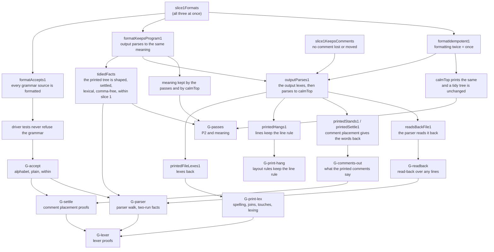

# Slice 1 proof map

How the proof that the self-hosted formatter is correct on slice 1 fits together, from the top theorems down to
the file groups that prove each step. [`GLOSSARY.md`](GLOSSARY.md) says what the words mean (Calm, Hangs,
Stands, Settled, ...); read its "The pipeline" section first if the formatter's stages are new to you.

## What is proved

For every source of slice 1's grammar (files of `def name: Type := value` over names, numerals, brackets,
tuples, lists, calls, signs, operators and `->`, with comments and blank lines anywhere) the formatter:

1. **accepts it** and gives an output text: [`formatAccepts1`](src/Fmt/Accepts1.sw);
2. **keeps the program**: the output parses, with the language's own parser, to a tree with the same `meaning`:
   [`formatKeepsProgram1`](src/Fmt/TopStatements.sw);
3. **is idempotent**: formatting the output gives the output: `formatIdempotent1` (same file);

and [`slice1Formats`](src/Fmt/TopStatements.sw) says all three about the language's own lexer and parser in one
statement. [`slice1KeepsComments`](src/Fmt/CommentsKeptProof.sw) beside it says no comment is lost or moved
to where it doesn't belong.

## How the proof goes, in one paragraph

The formatter lexes the source, moves comments to their place (*comment placement*), parses, tidies the tree
(only P2, dropping last commas, does anything in slice 1), and prints it through layout rules. To show the
output is right, the proof follows the **second run**: it shows that the printed text lexes back to the tree's
words (*lexes back*), that its lines obey the parser's indentation rule (*hangs*), that comment placement
on those leaves gives the tree's words back (*settles back*), and that the parser then gives the tree it printed
(*reads back*). Everything the second run reads is therefore the first run's tree, so the output parses to the
same program and formatting it again changes nothing. Acceptance is the other direction: each of the driver's
refusals is shown never to fire on the grammar. The parser is proved on source *and* output at once by showing
it behaves the same on inputs that differ only in comments (the *two-run* facts).

## Diagram

Boxes with a theorem name are statements; boxes in the bottom row are groups of files (listed below). An arrow
`A --> B` means "A is proved from B".

Reading order for a newcomer: the four top theorems, then the diagram's second row (each is a
`theorem` in `TopStatements.sw`, with a description saying how its proof goes), then one file group.

## The big facts, and where each is proved

| Fact (node) | Says | Statement | Proved mainly in |
|---|---|---|---|
| `formatAccepts1` | the driver refuses nothing in the grammar | [`Fmt/Accepts1.sw`](src/Fmt/Accepts1.sw) | G-accept, G-settle, G-parser |
| `tidiedFacts` | the tree the driver prints is within slice 1, shaped, settled, lexical and comma-free | [`Fmt/TopStatements.sw`](src/Fmt/TopStatements.sw) | G-parser, G-passes |
| `printedFileLexes1` | the printed text lexes to the leaves the tree says | [`Fmt/OutputStatements.sw`](src/Fmt/OutputStatements.sw) (`SourceFile.lexed`) | G-print-lex |
| `printedHangs1` | each declaration's printed leaves keep the line rule (`hangs`) | [`Fmt/DeclFactsProofs.sw`](src/Fmt/DeclFactsProofs.sw) | G-print-hang |
| `printedStands1`, `printedSettle1` | the printed leaves carry the tree's comments where `stands` says, and comment placement puts them back on the tree's words | [`Fmt/TriviaStatements.sw`](src/Fmt/TriviaStatements.sw), [`Fmt/SettleOutputProofs.sw`](src/Fmt/SettleOutputProofs.sw) | G-comments-out, G-settle |
| `readsBackFile1` | the parser on the settled leaves gives `calmTop` of the printed tree | [`Fmt/TopReadBack.sw`](src/Fmt/TopReadBack.sw) | G-readback, G-parser |
| `firstThreeKeepMeaning`, `calmTopMeans` | the passes and `calmTop` keep `meaning` | [`Fmt/Meaning.sw`](src/Fmt/Meaning.sw) | G-passes |
| `calmTopPrints`, `tidySame1` | `calmTop` prints as `calm` does, and tidying a tidy tree changes nothing | [`Fmt/CalmTopProofs.sw`](src/Fmt/CalmTopProofs.sw) | G-passes |

## File groups

Every `.sw` file under `src/` (but `Tests/`) is in exactly one group; `dev/check-glossary.sh` checks the list is
complete. Paths are under `src/`. `Fmt` files are the formatter's; `Syntax` files are the language's lexer and
parser (used as the proof's ground) with the proofs about them.

| Group | What it holds | Files |
|---|---|---|
| **G-top** | the top theorems | `Fmt/TopStatements.sw`, `Fmt/Accepts1.sw`, `Fmt/CommentsKeptProof.sw` |
| **G-defs** | the definitions the statements use: grammar, driver, predicates, what "same program" means | `Fmt/Grammar1.sw`, `Fmt/Driver1.sw`, `Fmt/Slice1.sw`, `Fmt/Kinds.sw`, `Fmt/Predicates.sw`, `Fmt/OutputStatements.sw`, `Fmt/TriviaStatements.sw`, `Fmt/OneLineStatements.sw`, `Fmt/Meaning.sw`, `Fmt/GroupFacts.sw`, `Fmt/OperatorList.sw`, `Fmt/WordsEdge.sw` |
| **G-program** | the code the proof is about (not proofs): printer rules, tidy passes, spacing, blanking, and the harness | `Fmt/Rules.sw`, `Fmt/Passes.sw`, `Fmt/Spacing.sw`, `Fmt/Blank.sw`, `Fmt/Twin.sw`, `Fmt/DocDump.sw`, `Fmt/Slice2.sw`, `Fmt/Slice3.sw`, `Fmt/Slice4a.sw`, `Fmt/Slice4b.sw`, `Fmt/Slice4c.sw`, `Fmt/Slice5a.sw`, `Fmt/Slice6a.sw` |
| **G-accept** | each driver test passes on the grammar | `Fmt/SourcePlainProofs.sw`, `Fmt/SettleParseProofs.sw`, `Fmt/PlacedProofs.sw` |
| **G-passes** | P2 and the other passes keep what matters; `meaning`; `calm` | `Fmt/PassProofs.sw`, `Fmt/MergeProofs.sw`, `Fmt/MeaningProofs.sw`, `Fmt/BlankProofs.sw`, `Fmt/Walk.sw`, `Fmt/TraverseFail.sw`, `Fmt/CalmProofs.sw`, `Fmt/CalmTopProofs.sw`, `Fmt/UnreturnedProofs.sw` |
| **G-print-lex** | the printed text lexes to the right tokens, spelt and spaced as the tree says | `Fmt/FileLexProofs.sw`, `Fmt/OutputFileProofs.sw`, `Fmt/TokenProofs.sw`, `Fmt/SpellProofs.sw`, `Fmt/JoinProofs.sw`, `Fmt/TreeJoinProofs.sw`, `Fmt/PrintLexProofs.sw`, `Fmt/FinishProofs.sw`, `Fmt/GlueProofs.sw`, `Fmt/SpacingProofs.sw`, `Fmt/TouchProofs.sw`, `Fmt/TouchSeq.sw`, `Fmt/TouchSteps.sw` |
| **G-print-hang** | the layout rules keep the parser's line rule at every width and with comments anywhere | `Fmt/HangProofs.sw`, `Fmt/DeclHangProofs.sw`, `Fmt/DeclFactsProofs.sw`, `Fmt/BracketHangProofs.sw`, `Fmt/ChainHangProofs.sw`, `Fmt/AppHangProofs.sw`, `Fmt/HeldParenProofs.sw`, `Fmt/ExprHangProofs.sw`, `Fmt/EdgeDeclProofs.sw`, `Fmt/EdgeHangProofs.sw`, `Fmt/EdgeKeyProofs.sw`, `Fmt/QuietKeyProofs.sw`, `Fmt/TrailsProofs.sw`, `Fmt/MarkProofs.sw`, `Fmt/PrintHangProofs.sw`, `Fmt/LaysKinds.sw`, `Fmt/LedProofs.sw`, `Fmt/Elements*.sw` |
| **G-comments-out** | where the printed comments land, and what comment placement then does | `Fmt/StandsProofs.sw`, `Fmt/HearProofs.sw`, `Fmt/ToldWordProofs.sw`, `Fmt/ToldDeclProofs.sw`, `Fmt/SettleOutputProofs.sw` |
| **G-readback** | the parser, given the printed leaves, reads the printed declaration back | `Fmt/TopReadBack.sw`, `Fmt/ReadBackFile.sw`, `Fmt/GroupSlots.sw`, `Fmt/SpeltSlots.sw`, `Fmt/SplitProofs.sw`, `Fmt/PrefixHeadSplit.sw`, `Syntax/ReadBack*.sw` |
| **G-lexer** | the lexer (the code) and its proofs: soundness, spelling, comments | `Syntax/Lexer.sw`, `Syntax/Token.sw`, `Syntax/Tree.sw`, `Syntax/Expr.sw`, `Syntax/Decl.sw`, `Syntax/Dump.sw`, `Syntax/LexProofs.sw`, `Syntax/LexLaidProofs.sw`, `Syntax/LexReadsProofs.sw`, `Syntax/LexUnreturnedProofs.sw`, `Syntax/GoodItemProofs.sw` |
| **G-settle** | comment placement (the code) and its proofs: keeps tokens, keeps comments, homes comments, bare last commas | `Syntax/Settle.sw`, `Syntax/SettleProofs.sw`, `Syntax/SettleBareProofs.sw`, `Syntax/SettleMarkProofs.sw`, `Syntax/SettleOnceProofs.sw`, `Syntax/SettleSplitProofs.sw`, `Syntax/GlueQuietProofs.sw`, `Syntax/OnceUnreturnedProofs.sw` |
| **G-parser** | the parser (the code), its walk (words, kinds, shape, within) and the two-run facts | `Syntax/Parser.sw`, `Syntax/DeclParser.sw`, `Syntax/Statements.sw`, `Syntax/Lowering.sw`, `Syntax/Traverse.sw`, `Syntax/AutoPlaced.sw`, `Syntax/SharedFacts.sw`, `Syntax/DeafProofs.sw`, `Syntax/Follows*.sw`, `Syntax/Parse*.sw` |

## Inside the groups

- **G-print-hang** is the biggest. `Fmt/HangProofs.sw` defines the fold (`HangState.step`) over the printer's trace
  and proves the basic steps. Then one file per node kind: brackets (`BracketHangProofs`), operator chains
  (`ChainHangProofs`), calls (`AppHangProofs`), a paren whose opener ends its line with a comment
  (`HeldParenProofs`). The `Elements*.sw` files carry the induction over the expression that says every node
  meets its facts with comments anywhere (`declElements1` in `ElementsProofs.sw`); `DeclHangProofs.sw` ends with
  the declaration.
- **G-print-lex** has two halves: the printer says which words touch (`Touch*`, `GlueProofs`,
  `SpacingProofs`) and which pieces may follow which (`JoinProofs`, `TreeJoinProofs`, `PrintLexProofs`); the lexer
  proofs say what that lexes to (`FileLexProofs`, `OutputFileProofs`).
- **G-parser** is two ideas. The *walk* (`ParseWalk*`, `ParseKept`, `ParseCarries*`) shows every parser
  function gives a tree with the words of the items it read. The *two-run* facts (`Follows*`, `DeafProofs`)
  show the parser treats inputs that differ only in comments alike. See "The parser, run twice" in the glossary.

## Staying true

`dev/check-glossary.sh` (run from anywhere) checks that every `` `name` (path:line) `` reference in
`GLOSSARY.md` and this page still names that line of an existing file, that every link here exists, and that
every `.sw` file under `src/` (but `Tests/`) is in a group above. Line numbers drift when files are edited;
rerun it after touching a file the glossary names and fix the references it reports. Nothing here is checked by the
Stitchwort kernel; the theorem statements are.
